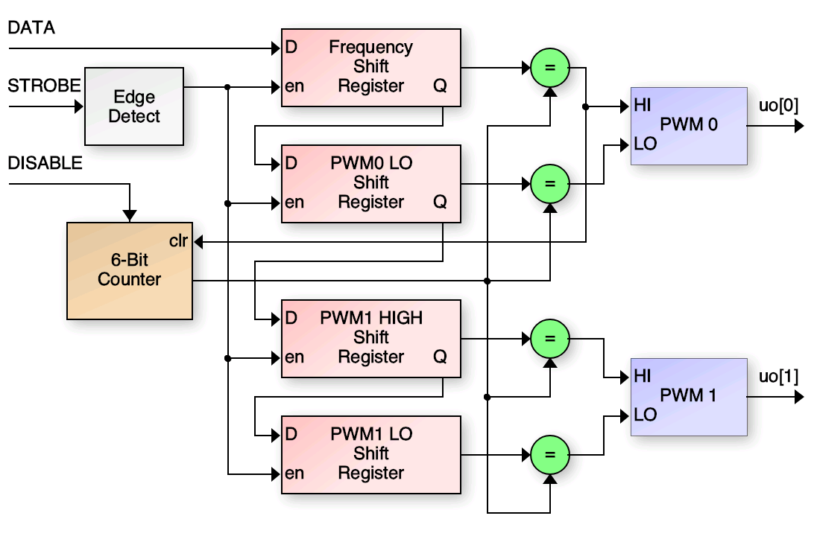

  

# Micro PWM

A single-channel PWM with two outputs, drawn in [Wokwi](https://wokwi.com/projects/481793265415286785)
and small enough for a Tiny Tapeout sky130 **micro tile** (a quarter of a 1x1 tile, with only
`clk`, `rst_n`, `ui_in` and `uo_out`). It is submitted to the ttsky26e shuttle as
`tt_um_pettit_micropwm`.

- [Read the documentation for the project](docs/info.md)

<picture>
  <source media="(prefers-color-scheme: dark)" srcset="docs/micropwm_block_dark.png">
  <source media="(prefers-color-scheme: light)" srcset="docs/micropwm_block.png">
  
</picture>

## How it works

A 6-bit counter runs on the clock, and four 6-bit registers are compared with it to shape the
two outputs:

| Register     | Function                                 |
|--------------|------------------------------------------|
| FREQUENCY    | Counter reset compare, and PWM0 goes HIGH |
| PWM0_LOW_CNT | Count where PWM0 goes LOW                |
| PWM1_HI_CNT  | Count where PWM1 goes HIGH               |
| PWM1_LOW_CNT | Count where PWM1 goes LOW                |

When the counter equals FREQUENCY it is cleared, so FREQUENCY sets the period; the same match
sets the PWM0 output high. The other three registers set where PWM0 falls and where PWM1 rises
and falls, so the two outputs share a period but have their own duty and phase.

The four registers form one 24-bit shift register. Each rising edge of STROBE (detected in the
clock domain) shifts in the bit on DATA. Each register is sent most significant bit first, in
the order PWM1_LOW_CNT, PWM1_HI_CNT, PWM0_LOW_CNT, FREQUENCY.

DISABLE stops the counter so that new values can be loaded. A reset loads usable values into
the registers and clears the counter, so the design does something visible without being
programmed.

## Pins

| Pin     | Function |
|---------|----------|
| `ui[0]` | DATA: the next register bit |
| `ui[1]` | STROBE: a rising edge shifts DATA in |
| `ui[2]` | DISABLE: high stops the counter |
| `uo[0]` | PWM 0 |
| `uo[1]` | PWM 1 |

## How to test

Supply a 50 Hz clock and issue a reset. The reset values make two segments of the demo
board's 7-segment display blink with different on and off times.

To try other patterns, raise DISABLE, strobe in 24 new register bits and lower DISABLE again.

## External hardware

The 7-segment display on the Tiny Tapeout demo board. A WebSerial app is planned for when the
chip is available.

## What is Tiny Tapeout?

Tiny Tapeout is an educational project that makes it easier and cheaper than ever to get
digital and analog designs manufactured on a real chip. To learn more, visit
https://tinytapeout.com.
