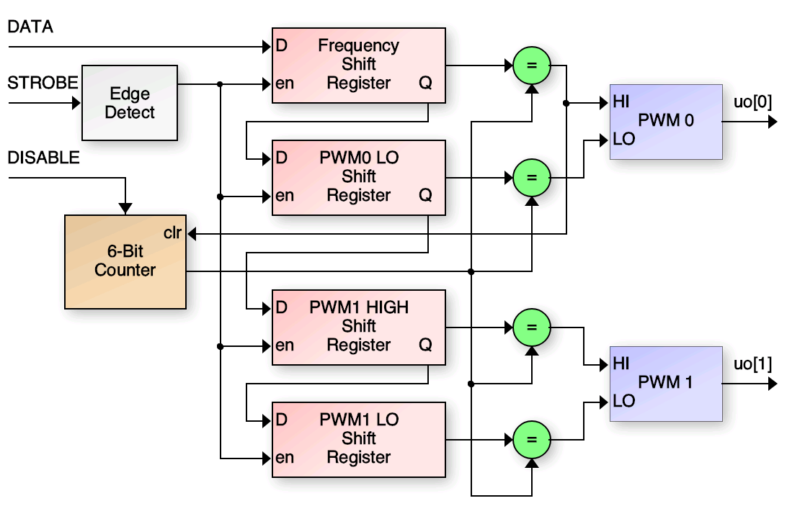

## How it works

This is a Wokwi design that fits in a sky130 'micro' tile and implements a single-channel,
dual output PWM.  It uses four 6-bit registers to set the two PWM output characteristics and
a 6-bit counter.  The registers are:

 | Register     | Function                                        |
 | ------------ | ----------------------------------------------- |
 | FREQUENCY    | Counter reset compare and PWM0 HIGH             |
 | PWM0_LOW_CNT | Count where PWM0 out goes LOW                   |
 | PWM1_HI_CNT  | Count where PWM1 out goes HIGH                  |
 | PWM1_LOW_CNT | Count where PWM1 out goes LOW                   |

There are three inputs ... DISABLE, DATA and STROBE.  The DISABLE input stops
the counter so new PWM data can be loaded.  The DATA and STROBE inputs are used to shift in
new control register data.  The next bit of data is presented on DATA and is sampled at the 
rising edge of STROBE.  Data is shifted MSB first and is shifted in the order:  PWM1_LOW_COUNT,
PWM1_HIGH_COUNT, PWM0_LOW_COUNT, FREQUENCY.  The FREQUENCY match also sets PWM0 HIGH.

Issuing a reset will pre-load "sane" values into
the control registers and zero the counter so a quick demo / test is possible.

## How to test

Supply a 50 Hz clock and issue a reset.  The default reset values will pre-load
frequency and duty cycle values to make two of the 7-segment LEDs blink with different
on/off times.

Disable the PWM, Strobe in different control register values and re-enable to see different 2-output patterns.

## External hardware

7-Segment display on the demo board.  A WebSerial app will be created once the chip is available.

